  

  
  
  
  
  
  
  

---

# 🚀 Awesome Swift Development Utilities

A comprehensive, production-grade curated catalog of **Swift development utilities**, **SaaS developer platforms**, and **open-source tooling** designed for Apple platform engineers (iOS, iPadOS, macOS, watchOS, tvOS, visionOS) and server-side Swift practitioners.

Whether you are scaling continuous integration/continuous deployment (CI/CD) pipelines, eliminating `.pbxproj` merge conflicts with declarative Xcode project generators, enforcing strict style rules with static analysis, or managing modular architectures with package managers, this repository tracks the best tools in the modern Swift ecosystem.

---

## 📑 Table of Contents

- [📊 Sector Overview & Market Dynamics](#-sector-overview--market-dynamics)
- [☁️ SaaS & Hosted CI/CD Platforms](#️-saas--hosted-cicd-platforms)
- [🐙 Open-Source GitHub Projects (Ranked by Stars)](#-open-source-github-projects-ranked-by-stars)
  - [1. Continuous Deployment & Pipeline Automation](#1-continuous-deployment--pipeline-automation)
  - [2. Code Quality, Linters & Formatters](#2-code-quality-linters--formatters)
  - [3. Dependency & Package Managers](#3-dependency--package-managers)
  - [4. Project Generation & Architecture Toolchains](#4-project-generation--architecture-toolchains)
  - [5. Code Generation, Asset Typing & Metaprogramming](#5-code-generation-asset-typing--metaprogramming)
  - [6. Testing, Mocking & Snapshot Utilities](#6-testing-mocking--snapshot-utilities)
  - [7. CLI Package Managers & Git Workflow Tools](#7-cli-package-managers--git-workflow-tools)
- [📈 Star History](#-star-history)
- [💖 Support & Sponsoring](#-support--sponsoring)
- [🤝 How to Contribute](#-how-to-contribute)
- [📜 License & Disclaimer](#-license--disclaimer)

---

## 📊 Sector Overview & Market Dynamics

The global mobile DevOps and Apple platform development utilities sector is valued at an estimated **$1.85 Billion in 2025** and projected to expand to **$4.30 Billion by 2030**, growing at a **Compound Annual Growth Rate (CAGR) of ~18.3%**.

Market dynamics exhibit a **moderately concentrated, platform-anchored ecosystem**:
- **Platform Concentration (Winner-Take-All Core)**: Apple holds proprietary gatekeeping over macOS compilation sandboxes, code signing certificates, notarization endpoints, and App Store Connect distribution APIs. This grants Apple's first-party SaaS offerings (**Xcode Cloud**, **TestFlight**) and Microsoft's hyper-scale cloud (**GitHub Actions macOS runners**) substantial structural advantage for base build execution.
- **Specialized Fragmentation (Best-of-Breed Tooling)**: High-performance mobile engineering teams rarely rely solely on single-vendor solutions. Cross-platform mobile pipelines, complex parallelized test matrices, manifest-driven `.xcodeproj` generation (Tuist, XcodeGen), and automated provisioning profile synchronization (Fastlane match) drive demand for specialized independent CI platforms (Bitrise, Codemagic) and vibrant community-maintained open-source CLI utilities.

---

## ☁️ SaaS & Hosted CI/CD Platforms

The table below summarizes leading hosted development platforms for Swift and iOS/macOS engineering. Entries are **sorted descending by company valuation and market capitalization**.

| 🌐 Platform / Tool | 🏢 Valuation / Company Size | ⚙️ Core Capabilities & Architecture | 💳 Starting Tier Pricing | 🎁 Free Tier Limits |
| :--- | :--- | :--- | :--- | :--- |
| **[Xcode Cloud](https://developer.apple.com/xcode-cloud/)** | **Apple Inc.** • Valuation: ~$3.40 Trillion • Revenue: $391.0B | Native Apple-integrated CI/CD built directly into Xcode; automated code signing; parallelized device/OS testing matrix; direct distribution to TestFlight. | **$49.95/month** for 100 compute hours ($99.95/month for 250 hrs; requires $99/year Apple Developer membership) | **25 compute hours/month included free forever** with standard Apple Developer Program membership. |
| **[TestFlight](https://testflight.apple.com/)** | **Apple Inc.** • Valuation: ~$3.40 Trillion • Revenue: $391.0B | Official Apple beta distribution endpoint supporting iOS, iPadOS, macOS, tvOS, watchOS, and visionOS builds with automatic crash feedback and session metrics. | **$0.00 additional cost** (included with Apple Developer Program at $99.00/year) | **Free forever** for up to 10,000 external public testers and 100 internal team testers (90-day build expiry). |
| **[GitHub Actions](https://github.com/features/actions)** | **Microsoft Corp.** • Valuation: ~$3.15 Trillion • Revenue: $245.1B | Ubiquitous YAML workflow orchestration with official Apple Silicon (M1/M2) and Intel macOS runners, deep repository integration, and extensive community Actions. | **$4.00/user/month** (GitHub Team) + **$0.016/min** on macOS M1/M2 runners ($0.08/min on standard 4-core macOS) | **2,000 build minutes/month free forever** on private repos; **100% unlimited free minutes** on public open-source repos. |
| **[Visual Studio App Center](https://appcenter.ms/)** *(Retired)* | **Microsoft Corp.** • Valuation: ~$3.15 Trillion • Revenue: $245.1B | Former mobile CI/CD, crash reporting, and app distribution suite. **Officially retired March 31, 2025**; diagnostics migration open to Azure Monitor through March 2027. | **Service Retired / Deprecated** (Legacy tier was $40.00/month per build pipeline concurrency) | **Service Retired**: New account registrations and builds disabled; diagnostic migration active until March 31, 2027. |
| **[CircleCI](https://circleci.com/)** | **Circle Internet Services** • Valuation: ~$1.70 Billion • Revenue: ~$110M | Enterprise continuous integration engine featuring dedicated macOS Apple Silicon executors, intelligent test splitting, Docker layer caching, and Xcode orbs. | **$15.00/month** for Performance Tier (includes 30,000 credits/month; macOS runners consume 50–100 credits/min) | **6,000 build minutes (30,000 credits)/month free forever** with up to 5 concurrent build jobs. |
| **[Bitrise](https://www.bitrise.io/)** | **Bitrise Ltd.** • Valuation: ~$600 Million • Revenue: ~$45M | Purpose-built mobile CI/CD platform featuring 400+ pre-configured mobile integrations, visual workflow designer, and dedicated Apple Silicon M1/M2 build machines. | **$89.00/month** for Starter Tier (annual billing) or **$200.00/month** for Pro plan with dedicated concurrency | **Hobby Plan free forever**: 300 credits/month, 1 concurrency, 30-min build limit (or **14-day free trial** of Team tier). |
| **[Codemagic](https://codemagic.io/)** | **Nevercode Ltd.** • Valuation: ~$50 Million • Revenue: ~$15M | Developer-centric CI/CD tailored for Swift native and Flutter/React Native mobile applications with automated code signing and zero-config App Store deployment. | **$95.00/month** for Professional Tier (includes 3 concurrent pipelines) or **$0.045/build min** on Mac mini M2 pay-as-you-go | **500 build minutes/month free forever** on standard M2 virtual machines (plus **14-day free trial** of Professional plan). |

---

## 🐙 Open-Source GitHub Projects (Ranked by Stars)

All open-source tools below are **sorted in strictly descending order by their GitHub Stars_Count**. Each tool includes a social Stars_Badge linking directly to that repository's stargazers page.

---

### 1. **[Fastlane](https://github.com/fastlane/fastlane)** 
- **Primary Domain**: Continuous Delivery & Pipeline Automation
- **GitHub Repository**: [fastlane/fastlane](https://github.com/fastlane/fastlane)
- **Description**: The industry-standard open-source automation engine for iOS and Android deployment. Define customized lanes in a declarative `Fastfile` to automate screenshot generation (`snapshot`), code signing certificate synchronization (`match`), provisioning profile management, beta distribution (`pilot`), and final App Store submission (`deliver`). Integrates seamlessly with all major CI runners.

### 2. **[SwiftLint](https://github.com/realm/SwiftLint)** 
- **Primary Domain**: Code Quality & Static Analysis
- **GitHub Repository**: [realm/SwiftLint](https://github.com/realm/SwiftLint)
- **Description**: The benchmark static code linter for Swift, enforcing community guidelines and clean architectural conventions. Powered by SourceKit and SwiftSyntax, it includes 200+ configurable rules, automatic autocorrection (`swiftlint --fix`), and integration via Xcode Build Tool Plugins or pre-commit hooks.

### 3. **[Carthage](https://github.com/Carthage/Carthage)** 
- **Primary Domain**: Decentralized Dependency Management
- **GitHub Repository**: [Carthage/Carthage](https://github.com/Carthage/Carthage)
- **Description**: A lightweight, non-intrusive dependency manager that builds binary frameworks without modifying your `.xcodeproj` or workspace settings. Ideal for teams seeking total control over linking and building reusable XCFrameworks using clean `Cartfile` specifications.

### 4. **[CocoaPods](https://github.com/CocoaPods/CocoaPods)** 
- **Primary Domain**: Centralized Dependency Management
- **GitHub Repository**: [CocoaPods/CocoaPods](https://github.com/CocoaPods/CocoaPods)
- **Description**: The historic pioneer of iOS dependency resolution. Built in Ruby, CocoaPods resolves complex transitive dependency graphs through a central Spec repository and integrates them cleanly into generated `.xcworkspace` environments.

### 5. **[Swift Package Manager](https://github.com/swiftlang/swift-package-manager)** 
- **Primary Domain**: Official Apple Package Manager & Build System
- **GitHub Repository**: [swiftlang/swift-package-manager](https://github.com/swiftlang/swift-package-manager)
- **Description**: Apple's official first-party system for managing the distribution of Swift code. Natively integrated with Xcode, `swift-package-manager` handles compilation, linking, dependency resolution, and build plugins directly within `Package.swift` manifests across all Apple platforms and Linux.

### 6. **[Quick](https://github.com/Quick/Quick)** 
- **Primary Domain**: Behavior-Driven Testing Framework
- **GitHub Repository**: [Quick/Quick](https://github.com/Quick/Quick)
- **Description**: A behavior-driven development (BDD) testing framework for Swift and Objective-C. Inspired by RSpec, Specta, and Ginkgo, Quick pairs with Nimble to deliver human-readable test descriptions, structured nested contexts, and flexible assertion matchers.

### 7. **[R.swift](https://github.com/mac-cain13/R.swift)** 
- **Primary Domain**: Strongly Typed Resource Generation
- **GitHub Repository**: [mac-cain13/R.swift](https://github.com/mac-cain13/R.swift)
- **Description**: Eliminates fragile string-based identifiers for images, fonts, storyboards, nibs, and localization files. `R.swift` generates strongly typed compile-time constants (e.g., `R.image.heroBackground()`), preventing runtime crashes due to typos.

### 8. **[SwiftGen](https://github.com/SwiftGen/SwiftGen)** 
- **Primary Domain**: Asset & Asset Catalog Code Generator
- **GitHub Repository**: [SwiftGen/SwiftGen](https://github.com/SwiftGen/SwiftGen)
- **Description**: Automatically generates type-safe Swift code wrappers for project assets including Asset Catalogs (`xcassets`), Core Data models, localized strings, JSON/YAML files, and font definitions using customizable Stencil templates.

### 9. **[SwiftFormat](https://github.com/nicklockwood/SwiftFormat)** 
- **Primary Domain**: Code Formatting & Style Normalization
- **GitHub Repository**: [nicklockwood/SwiftFormat](https://github.com/nicklockwood/SwiftFormat)
- **Description**: A high-speed, highly configurable command-line code formatter and Xcode Source Editor extension. SwiftFormat goes beyond standard whitespace cleanup by normalizing syntax idioms, removing redundant closures, and enforcing consistent code organization.

### 10. **[XcodeGen](https://github.com/yonaskolb/XcodeGen)** 
- **Primary Domain**: Declarative Xcode Project Generation
- **GitHub Repository**: [yonaskolb/XcodeGen](https://github.com/yonaskolb/XcodeGen)
- **Description**: A lightweight CLI tool that generates `.xcodeproj` files on demand from a clean `project.yml` specification. By keeping project files out of version control, XcodeGen permanently eliminates git merge conflicts on `.pbxproj` files.

### 11. **[Sourcery](https://github.com/krzysztofzablocki/Sourcery)** 
- **Primary Domain**: Metaprogramming & Boilerplate Code Generator
- **GitHub Repository**: [krzysztofzablocki/Sourcery](https://github.com/krzysztofzablocki/Sourcery)
- **Description**: A metaprogramming engine for Swift that inspects AST structures to automate boilerplate code creation. Used extensively to synthesize `Equatable`, `Hashable`, `Codable`, mock implementations, and deep structural decorators via template annotations.

### 12. **[Periphery](https://github.com/peripheryapp/periphery)** 
- **Primary Domain**: Dead Code Identification & App Thinning
- **GitHub Repository**: [peripheryapp/periphery](https://github.com/peripheryapp/periphery)
- **Description**: An accurate, compiler-driven static analysis engine that identifies unused Swift declarations, uncalled functions, redundant protocol conformances, and orphaned properties, significantly shrinking binary size and technical debt.

### 13. **[Tuist](https://github.com/tuist/tuist)** 
- **Primary Domain**: Enterprise Project Architecture & Build Acceleration
- **GitHub Repository**: [tuist/tuist](https://github.com/tuist/tuist)
- **Description**: The premier toolchain for large-scale modular Apple apps. Tuist defines Xcode workspaces in pure Swift manifests (`Project.swift`), offers binary artifact caching to slash compilation times by up to 70%, and integrates with its cloud registry for package caching.

### 14. **[SnapshotTesting](https://github.com/pointfreeco/swift-snapshot-testing)** 
- **Primary Domain**: Snapshot & Visual Regression Testing
- **GitHub Repository**: [pointfreeco/swift-snapshot-testing](https://github.com/pointfreeco/swift-snapshot-testing)
- **Description**: Delightful, robust snapshot testing for iOS and macOS. Supports rendering UI views, SwiftUI structures, formatted text dumps, HTTP payloads, and PDF outputs into disk snapshots for regression verification.

### 15. **[xcpretty](https://github.com/xcpretty/xcpretty)** 
- **Primary Domain**: Build Log Formatter & Test Reporter
- **GitHub Repository**: [xcpretty/xcpretty](https://github.com/xcpretty/xcpretty)
- **Description**: A fast, flexible formatter for raw `xcodebuild` stdout. Translates verbose, unreadable Xcode terminal streams into clean, colored terminal summaries, JUnit test reports, and HTML status pages.

### 16. **[swift-format](https://github.com/swiftlang/swift-format)** 
- **Primary Domain**: Official Apple Swift Formatter
- **GitHub Repository**: [swiftlang/swift-format](https://github.com/swiftlang/swift-format)
- **Description**: The official formatting and linting tool maintained by the Swift open-source team. Built directly on SwiftSyntax, it provides authoritative formatting adhering to official Swift API design guidelines.

### 17. **[Mint](https://github.com/yonaskolb/Mint)** 
- **Primary Domain**: Executable Package Runner & Version Manager
- **GitHub Repository**: [yonaskolb/Mint](https://github.com/yonaskolb/Mint)
- **Description**: A package manager specialized in installing and running executable Swift command-line packages. Guarantees deterministic CLI tool versions across distributed engineering teams without modifying project repositories.

### 18. **[ios-builder](https://github.com/MobAI-App/ios-builder)** 
- **Primary Domain**: Cloud Build CLI & Non-Mac iOS Automation
- **GitHub Repository**: [MobAI-App/ios-builder](https://github.com/MobAI-App/ios-builder)
- **Description**: A modern Go-based CLI designed to trigger, compile, and distribute iOS applications without local macOS hardware, integrating directly with GitHub Actions, Bitrise, and Codemagic remote workers.

### 19. **[Mockolo](https://github.com/uber/mockolo)** 
- **Primary Domain**: High-Performance Mock Code Generator
- **GitHub Repository**: [uber/mockolo](https://github.com/uber/mockolo)
- **Description**: Uber's ultra-fast mock generator for Swift. Employs concurrent parsing via SwiftSyntax to generate mock test objects from annotated protocols in seconds, dramatically speeding up unit test authoring.

### 20. **[Swift Package Index Server](https://github.com/SwiftPackageIndex/SwiftPackageIndex-Server)** 
- **Primary Domain**: Package Discovery & Compatibility Engine
- **GitHub Repository**: [SwiftPackageIndex/SwiftPackageIndex-Server](https://github.com/SwiftPackageIndex/SwiftPackageIndex-Server)
- **Description**: The open-source backend powering the Swift Package Index. Indexes 10,000+ packages and conducts continuous build matrix compatibility runs across iOS, macOS, visionOS, Linux, and WebAssembly targets.

### 21. **[Komondor](https://github.com/shibapm/Komondor)** 
- **Primary Domain**: Git Hooks Automation for Swift
- **GitHub Repository**: [shibapm/Komondor](https://github.com/shibapm/Komondor)
- **Description**: Configures and runs git hooks (such as pre-commit linting and test runs) defined right inside your `Package.swift`, mimicking Husky for the native Swift ecosystem.

### 22. **[Swiftlane](https://github.com/swiftlane-code/Swiftlane)** 
- **Primary Domain**: Type-Safe Pure Swift CI Automation
- **GitHub Repository**: [swiftlane-code/Swiftlane](https://github.com/swiftlane-code/Swiftlane)
- **Description**: A type-safe alternative to Ruby Fastlane authored entirely in Swift. Features automatic provisioning profile handling, App Store Connect publishing, and encrypted git credentials storage with compile-time verification.

### 23. **[shlane](https://github.com/prongbang/shlane)** 
- **Primary Domain**: Minimalist YAML Pipeline Runner
- **GitHub Repository**: [prongbang/shlane](https://github.com/prongbang/shlane)
- **Description**: A lightweight shell-driven alternative for mobile build pipelines that executes lanes declared in minimalist YAML configuration files with zero runtime overhead.

---

## 📈 Star History

---

## 💖 Support & Sponsoring

Thank you for exploring **Awesome Swift Development Utilities**! Maintaining an up-to-date and thoroughly vetted registry of developer platforms, package management systems, and compilation workflows takes dedication and continuous research.

If this curated repository has saved you debugging time, solved an Xcode project merge conflict, or accelerated your CI/CD delivery, please consider supporting the project:

- 🌟 **Star this repository** to help fellow Apple platform developers discover these tools.
- 🍴 **Fork the project** and submit pull requests with fresh utilities or corrections.
- 📢 **Share this resource** with your engineering team, iOS communities, and Twitter/Mastodon.
- ☕ **Sponsor the Maintainer**: Support continuous open-source maintenance via the [GitHub Sponsors Dashboard](https://github.com/sponsors/ishandutta2007).

---

## 🤝 How to Contribute

We welcome contributions from the community! To suggest a new tool or update an existing entry:

1. **Fork the Repository**: Clone your fork locally.
2. **Review Formatting**: Follow the existing format with social Stars_Badges, clear domain classifications, and factual descriptions.
3. **Verify Compatibility**: Ensure the utility is compatible with modern Swift (Swift 5.9+ / Swift 6.0) and Xcode 15/16 environments.
4. **Submit a Pull Request**: Provide a brief summary of why the utility is beneficial to Apple platform developers.

---

## 📜 License & Disclaimer

- **License**: Released under the [MIT License](LICENSE).
- **Disclaimer**: All product names, trademarks, and registered trademarks belong to their respective owners. Mention of SaaS or open-source software does not constitute an official endorsement.
- Discover more awesome curated lists at [Awesome-Awesome-Awesome](https://github.com/ishandutta2007/Awesome-Awesome-Awesome).
